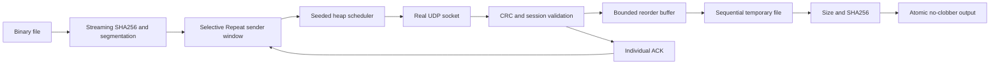

# Architecture

Modules separate wire codec, hashing, channel scheduling, sender, receiver,
TCP baseline, CLI and benchmarks. Sender memory O(window × chunk); receiver
memory O(window × chunk). Hashing uses 1 MiB streaming reads. Scheduled datagrams
have a hard queue cap. Receiver cache has a fixed cap and expiration.

## Phase 2 monitoring and evaluation

`dashboard.py` is an optional Rich presentation module. Protocol loops publish
scalar counters and at most 32 `(sequence, state)` cells every 200 ms. Rich refreshes
on its own thread at 5 Hz; payload bytes never enter display state. No transfer
history grows with file size. Terminal rendering still costs CPU and can perturb
scheduling, so all benchmark timings disable it; timing overhead is not yet profiled.

UDP receiver SHA-256 now consumes each contiguous chunk as it is written, in
sequence order. It checks the final digest and actual file size before publication.
This avoids a second large-file read while the sender waits for FIN_ACK. Hashing
memory is constant; input hashing still uses 1 MiB reads. The file is opened read-only
at the sender, and shortened sources fail promptly. Keep source files stable.
SIGINT and ordinary exceptions close sockets/streams; receiver `finally` deletes
partials. Sender interruption leaves a receiver partial until its idle timeout.
Forced process termination/power loss can leave `.part` files; no crash recovery
or resume is promised. Nothing extracts an archive or changes its original bytes.

`benchmark.py` owns synthetic generation, receiver thread lifecycle, actual trials,
CSV persistence, summaries and plots. `scripts/demo.py` composes these existing
APIs, starts real local sockets, and retains only synthetic demonstration evidence.
