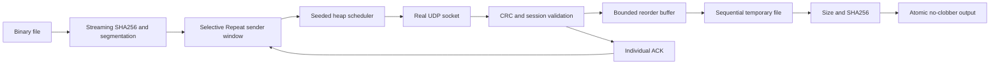

# Architecture

Modules separate wire codec, hashing, channel scheduling, sender, receiver,
TCP baseline, CLI and benchmarks. Sender memory O(window × chunk); receiver
memory O(window × chunk). Hashing uses 1 MiB streaming reads. Scheduled datagrams
have a hard queue cap. Receiver cache has a fixed cap and expiration.
